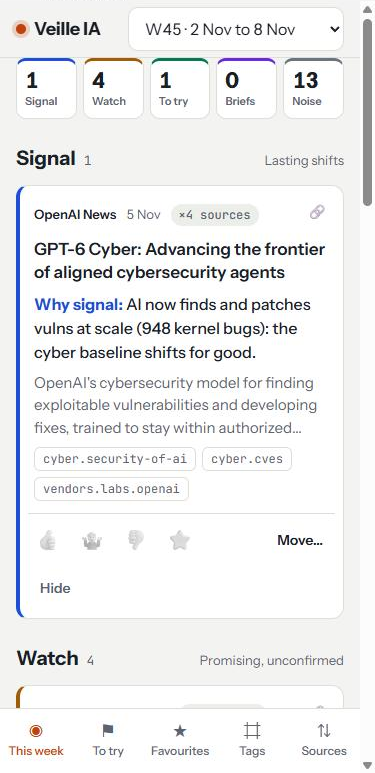
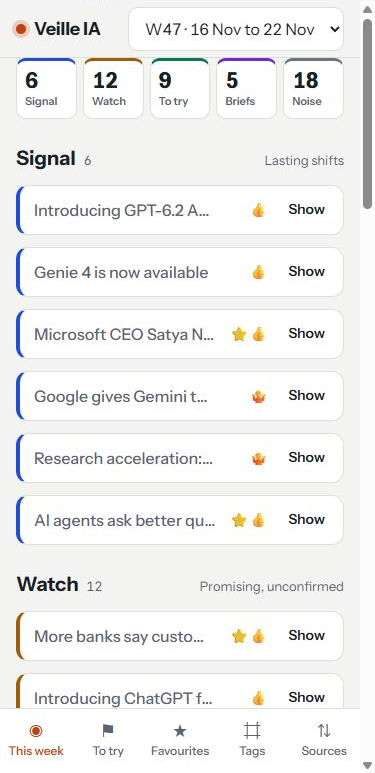
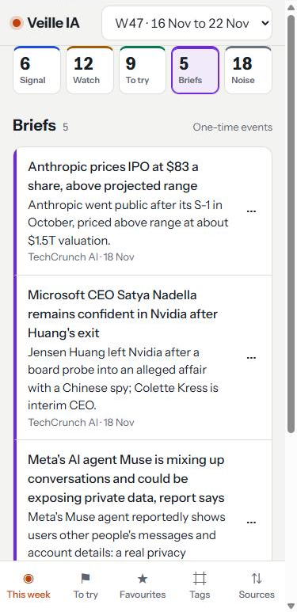
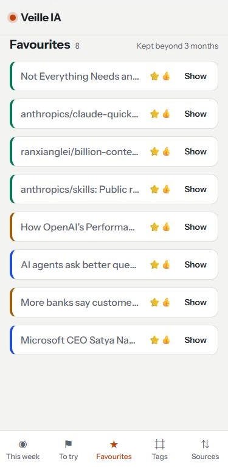
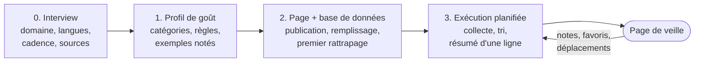
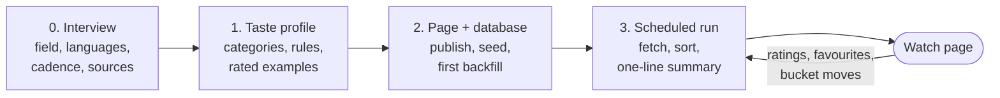

# News Monitoring Dashboard

**Un plugin Claude Code qui construit votre veille personnelle, pour n'importe quel domaine, et sépare le signal du bruit. / A Claude Code plugin that builds your personal news watch, for any field, and separates signal from noise.**

[](LICENSE)
[](CHANGELOG.md)
[](https://code.claude.com/docs/en/plugins)

**Français** · [English](#english)

|  |  |  |  |
|:---:|:---:|:---:|:---:|
| Semaine reçue, rien de trié<br/>*New week, nothing sorted yet* | Semaine presque triée<br/>*Week mostly sorted* | Liste des brèves<br/>*Briefs list* | Favoris<br/>*Favourites* |

---

<a id="francais"></a>

# Français

## Ce que ça fait

Vous répondez à une interview, Claude construit une page de veille mobile avec sa propre base de données. Chaque semaine (ou chaque jour), une tâche planifiée lit vos sources, supprime les doublons et trie l'actualité en cinq catégories. Vous notez, Claude apprend.

| Catégorie | Ce qu'on y trouve |
|---|---|
| **Essentiel** | Les évolutions de fond de votre domaine, probablement encore pertinentes dans 3 mois |
| **À surveiller** | Prometteur mais pas confirmé. Promu en Essentiel si le sujet dure |
| **À essayer** | Ce que vous pouvez utiliser maintenant : outils, méthodes, modèles, offres |
| **Brèves** | Les événements ponctuels qu'il faut connaître (ce qui s'est passé, pourquoi) |
| **Bruit** | Tout le reste, conservé mais replié |

**Le système apprend de vos actions :**

| Votre action | Ce que Claude en tire |
|---|---|
| 👍 / 🤷 / 👎 sur une carte | Votre goût (poids 1 / 0,5 / 0) |
| Favori | Un 👍 fort, conservé au-delà de l'archive de 3 mois |
| Déplacer une carte vers un autre bucket | Votre définition personnelle du « signal » (« Claude a dit X, vous avez dit Y ») |
| Statut À essayer (Adopté, Essayé, Abandonné) | Goût et utilité réelle |

À chaque exécution, Claude réécrit un profil de goût condensé à partir de ces retours, plutôt que d'entraîner un modèle.

## Comment ça marche



1. **Interview** : domaine, langues, cadence, packs de départ, sources (chacune est testée).
2. **Profil de goût** : vos catégories, votre définition du signal et du bruit, 10 à 15 vraies actualités à noter.
3. **Page et base** : la page est publiée (Artifact avec base de données), amorcée avec votre profil, puis un rattrapage des 4 dernières semaines évite une page vide.
4. **Exécution planifiée** : la tâche tourne à l'heure choisie, sans que votre ordinateur soit allumé. La boucle de retour (vos notes et déplacements) alimente l'exécution suivante.

## Prérequis

- **Claude Code** (application de bureau ou web).
- **Artifacts** avec la capacité `db` (pages publiées avec base de données).
- **Tâches planifiées**, plus WebFetch et la recherche web.
- Optionnel : un dossier local, pour garder des copies lisibles de votre profil et de vos sources.

## Installation

```
/plugin marketplace add Nassim1244/news-monitoring-dashboard
/plugin install news-monitoring-dashboard@news-monitoring-dashboard
```

## Démarrage rapide

1. Ouvrez **le dossier de votre veille** dans Claude Code (un dossier vide, ou un nouveau sous-dossier : le skill en propose un).
2. Lancez `/news-monitoring-dashboard:news-monitoring-dashboard`, ou demandez simplement : *« Mets en place une veille sur la cybersécurité »*.
3. Le skill regarde votre dossier et **détecte à quelle étape vous en êtes**. Vous pouvez donc faire une étape par session et reprendre plus tard.

| Étape | Durée | Résultat |
|---|---|---|
| 0. Interview | ~20 min | `config/watch-settings.md`, `config/sources.md` |
| 1. Profil de goût | ~30 min | `config/MyTaste.md` |
| 2. Page, base, premier rattrapage, planification | ~30 min | `artifact/index.html`, `run/recurring-run.md`, tâche planifiée |

**Au quotidien :**

- Ouvrez la page sur votre téléphone ou votre ordinateur.
- Notez les cartes, mettez en favori les meilleures, déplacez celles que Claude a mal rangées : chaque déplacement affine votre définition du signal.
- Acceptez ou rejetez les tags suggérés dans l'onglet Tags.
- Activez ou coupez des sources dans l'onglet Sources (une source en échec 3 fois de suite est signalée comme cassée).
- Après 3 ou 4 semaines, demandez à Claude de revoir les seuils À surveiller vers Essentiel avec vos notes.

**Conseils :** commencez petit (15 à 25 sources), puis élargissez quand les premières semaines vous conviennent. L'exemple `skills/news-monitoring-dashboard/references/examples/ai-watch/` montre la profondeur attendue d'un bon profil.

## Packs de départ

Un pack est un point de départ : arbre de tags, indices pour les règles de tri, sources candidates. Vous en choisissez 0 à 3 pendant l'interview, et rien n'est figé.

| Pack | Pour |
|---|---|
| **AI** | Modèles, agents, outils, adoption en entreprise |
| **Cybersecurity** | Menaces, vulnérabilités, réglementation, pratiques de défense |
| **Marketing** | Marketing digital, SEO, réseaux sociaux, CRM, martech |
| **Industry** | Industrie 4.0, production, supply chain, énergie en usine |

Les sources candidates ne sont **pas testées** à l'avance : l'interview teste chacune avec WebFetch et trouve le bon flux (seul le pack AI liste des flux testés en novembre 2026).

**Ajouter un pack :** copiez un fichier de `skills/news-monitoring-dashboard/references/packs/` et gardez les mêmes sections.

## Configuration

Les fichiers de votre veille vivent dans **votre dossier de travail**, pas dans le plugin.

| Fichier | Rôle |
|---|---|
| `config/watch-settings.md` | Domaine, langues, cadence, identifiant de la page |
| `config/sources.md` | Liste lisible des sources (langue, type, rôle, actif ou non) |
| `config/MyTaste.md` | Profil de goût et arbre de tags |
| `artifact/index.html` | La page de veille (mobile d'abord, thèmes clair et sombre) |
| `run/recurring-run.md` | Le prompt autonome de la tâche planifiée |
| `run/mirror-local.md` | Optionnel : copies lisibles sur votre disque, planifiées 1 à 2 h après l'exécution cloud |

| Réglage | Valeurs |
|---|---|
| Langues des sources | `fr`, `en` ou `fr+en` (les titres et extraits sont traduits, les doublons entre langues fusionnés) |
| Langue d'affichage | `fr` ou `en` (une autre langue fonctionne de la même façon) |
| Cadence | Hebdomadaire (par défaut) ou quotidienne |

## Coût et économie de tokens

La méthode est pensée pour rester légère :

- les extraits viennent des flux, Claude n'écrit **qu'une ligne** pour Essentiel, À surveiller, À essayer et Brèves ;
- plafond de 50 éléments par semaine (12 par jour en cadence quotidienne) ;
- traduction limitée aux titres (et aux extraits hors Bruit) ;
- les éléments déjà vus ne sont jamais retraités.

Comptez environ 15 à 30 minutes d'exécution par semaine pour 20 à 25 sources.

## Structure du dépôt

```
.claude-plugin/
  plugin.json
  marketplace.json
skills/news-monitoring-dashboard/
  SKILL.md                 point d'entrée, route selon l'étape
  assets/                  modèles de config, de run et de page
  references/
    spec.md                la méthode
    data-model.md          collections de la base
    step-0-interview.md
    step-1-taste.md
    step-2-build-page.md
    packs/                 AI, cybersécurité, marketing, industrie
    examples/ai-watch/     exemple complet anonymisé
CHANGELOG.md
LICENSE
```

## Feuille de route

Hors périmètre de la v1 (voir la section « Out of scope » de `spec.md`) : temps réel et notifications, sources nécessitant une connexion ou bloquant la lecture automatique (réseaux sociaux, plateformes vidéo), multi-utilisateur et partage, modèle entraîné.

Pistes envisagées, sans engagement :

- [ ] davantage de packs de départ ;
- [ ] lecture via navigateur pour les sources qui bloquent WebFetch ;
- [ ] une démo vidéo ;
- [ ] davantage de langues d'affichage ;
- [ ] réglage automatique des seuils À surveiller vers Essentiel.

## Licence

[AGPL-3.0](LICENSE).

## Auteur

[Nassim1244](https://github.com/Nassim1244)

[Retour en haut](#francais) · [English version](#english)

---

<a id="english"></a>

# English

[Version française](#francais)

## What it does

You answer an interview, Claude builds a mobile news page with its own database. Every week (or every day), a scheduled task reads your sources, removes duplicates and sorts the news into five buckets. You rate, Claude learns.

| Bucket | What goes there |
|---|---|
| **Signal** | Lasting shifts in your field, likely still relevant in 3 months |
| **Watch** | Promising but not confirmed yet. Promoted to Signal if it lasts |
| **To try** | Things you can use now: tools, methods, templates, offers |
| **Briefs** | One-time events worth knowing (what happened, why) |
| **Noise** | Everything else, kept but collapsed |

**The system learns from what you do:**

| Your action | What Claude takes from it |
|---|---|
| 👍 / 🤷 / 👎 on a card | Your taste (weight 1 / 0.5 / 0) |
| Favourite | A strong 👍, kept beyond the 3-month archive |
| Moving a card to another bucket | Your own definition of "signal" ("Claude said X, you said Y") |
| To try status (Adopted, Tried, Dropped) | Taste and real usefulness |

Each run, Claude rewrites a distilled taste profile from this feedback instead of training a model.

## How it works



1. **Interview:** field, languages, cadence, starting packs, sources (each one is tested).
2. **Taste profile:** your categories, your definition of signal and noise, 10 to 15 real news items for you to rate.
3. **Page and database:** the page is published (an Artifact with a database), seeded with your profile, then a 4-week backfill so it is not empty.
4. **Scheduled run:** the task runs at your chosen time, without your computer being on. The feedback loop (your ratings and moves) feeds the next run.

## Requirements

- **Claude Code** (desktop app or web).
- **Artifacts** with the `db` capability (published pages with a database).
- **Scheduled tasks**, plus WebFetch and web search.
- Optional: a local folder, to keep readable copies of your profile and sources.

## Install

```
/plugin marketplace add Nassim1244/news-monitoring-dashboard
/plugin install news-monitoring-dashboard@news-monitoring-dashboard
```

## Quick start

1. Open **your watch folder** in Claude Code (an empty folder, or a new subfolder: the skill proposes one).
2. Run `/news-monitoring-dashboard:news-monitoring-dashboard`, or just ask: *"Set up a news watch on cybersecurity"*.
3. The skill looks at your folder and **detects which step you are at**, so you can do one step per session and resume later.

| Step | Time | Output |
|---|---|---|
| 0. Interview | ~20 min | `config/watch-settings.md`, `config/sources.md` |
| 1. Taste profile | ~30 min | `config/MyTaste.md` |
| 2. Page, database, first backfill, schedule | ~30 min | `artifact/index.html`, `run/recurring-run.md`, scheduled task |

**Daily use:**

- Open the page on your phone or computer.
- Rate cards, favourite the best ones, move cards Claude put in the wrong bucket: every move sharpens your idea of signal.
- Accept or reject the tags Claude suggests in the Tags tab.
- Turn sources on or off in the Sources tab (a source that fails 3 runs in a row is flagged as broken).
- After 3 or 4 weeks, ask Claude to review the Watch to Signal thresholds with your ratings.

**Tips:** start small (15 to 25 sources), then add more once the first weeks look right. The example in `skills/news-monitoring-dashboard/references/examples/ai-watch/` shows how detailed a good taste profile is.

## Starting packs

A pack is a starting point: a tag tree, hints for the sorting rules and candidate sources. You pick 0 to 3 during the interview, and nothing is final.

| Pack | For |
|---|---|
| **AI** | Models, agents, tools, adoption in companies |
| **Cybersecurity** | Threats, vulnerabilities, regulation, defense practice |
| **Marketing** | Digital marketing, search, social, CRM, martech |
| **Industry** | Industry 4.0, manufacturing, supply chain, energy in plants |

Candidate sources are **not tested** in advance: the interview tests each one with WebFetch and finds the right feed (only the AI pack lists feeds tested in November 2026).

**Add a pack:** copy a file from `skills/news-monitoring-dashboard/references/packs/` and keep the same sections.

## Configuration

Your watch files live in **your workspace folder**, not in the plugin.

| File | Role |
|---|---|
| `config/watch-settings.md` | Field, languages, cadence, page id |
| `config/sources.md` | Readable source list (language, type, role, on or off) |
| `config/MyTaste.md` | Taste profile and tag tree |
| `artifact/index.html` | The watch page (mobile first, light and dark themes) |
| `run/recurring-run.md` | The self-contained prompt of the scheduled task |
| `run/mirror-local.md` | Optional: readable copies on your disk, scheduled 1 to 2 hours after the cloud run |

| Setting | Values |
|---|---|
| Source languages | `fr`, `en` or `fr+en` (titles and excerpts are translated, duplicates across languages merged) |
| Display language | `fr` or `en` (any other language works the same way) |
| Cadence | Weekly (default) or daily |

## Cost and token economy

The method is built to stay light:

- excerpts come from the feeds, Claude writes **one line only** for Signal, Watch, To try and Briefs;
- cap of 50 items per week (12 per day on a daily cadence);
- translation limited to titles (and to excerpts outside Noise);
- items already seen are never processed twice.

Count roughly 15 to 30 minutes of run time per week for 20 to 25 sources.

## Repository layout

```
.claude-plugin/
  plugin.json
  marketplace.json
skills/news-monitoring-dashboard/
  SKILL.md                 entry point, routes by step
  assets/                  config, run and page templates
  references/
    spec.md                the method
    data-model.md          database collections
    step-0-interview.md
    step-1-taste.md
    step-2-build-page.md
    packs/                 AI, cybersecurity, marketing, industry
    examples/ai-watch/     complete anonymized example
CHANGELOG.md
LICENSE
```

## Roadmap

Out of scope for v1 (see "Out of scope" in `spec.md`): real-time updates and notifications, sources that need a login or block automated reading (social networks, video platforms), multi-user and sharing, a trained ML model.

Ideas under consideration, no commitment:

- [ ] more starting packs;
- [ ] browser-based fetching for sources that block WebFetch;
- [ ] a video demo;
- [ ] more display languages;
- [ ] automatic tuning of the Watch to Signal thresholds.

## License

[AGPL-3.0](LICENSE).

## Author

[Nassim1244](https://github.com/Nassim1244)

[Back to top](#english) · [Version française](#francais)
